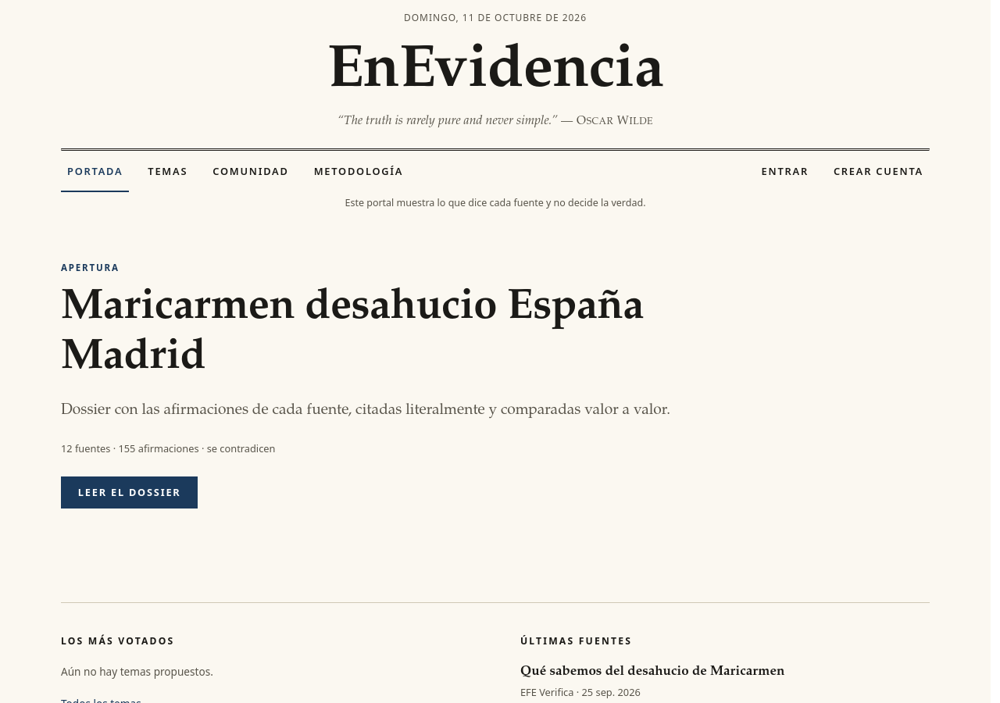

# EnEvidencia

🇪🇸 [Leer en español](README.md)



> “The truth is rarely pure and never simple.” — Oscar Wilde

An open-source local portal that gathers claims from different sources about the same fact, stores them with their provenance and shows them side by side. **It does not decide what is true.**

> 🚧 **Status: under construction.** The project is in active development; expect bugs, structural changes and unfinished features.
>
> 🤖 **How it was built:** developed with the help of Claude (Claude Code), an AI assistant. I define the idea, the principles and the design decisions, and I review and test the result; a good part of the code was written by the AI.

## Installation
```bash
python -m venv .venv
source .venv/bin/activate
pip install -r requirements.txt
pip install -e .
```

## Usage
```bash
enevidencia          # opens the portal at http://127.0.0.1:8000
```
### AI-assisted mode ("Research topic")
Type a topic on the home page. A single background job (with a progress page, stages and visible errors) does everything **without you accepting or discarding anything** (so your bias is not introduced): 1) the AI generates neutral queries and sources are downloaded (HTML and PDFs with text); 2) the code filters using objective, deterministic criteria from `config/pipeline.yaml` (minimum length, terms distinctive to the topic, no duplicates, maximum per domain and in total; none of them measures reliability or stance) and accepts or excludes each source with a human-readable reason; 3) the AI extracts claims from the accepted sources, one by one while respecting the quota, and the code saves only those with a verified literal quote; 4) the fact is compared and displayed. If the quota runs out midway, the result is partial and what has been saved is kept.

The **Audit** page (`/facts/{id}/audit`) lists the queries, all sources with their status and reason, the discarded claims, and the breakdown of accepted ones by type and by domain. The on-page report includes a **Methodology** section with the same in summary. Afterwards you can correct things by hand on the review screen (discreetly linked), group by point with AI, and generate the report with AI-written prose. Residual bias: the search engine and the AI may influence which sources appear; this is mitigated with neutral, varied queries and full transparency.

**Setting up the key (free):**
1. Create a key at <https://aistudio.google.com/apikey>.
2. In the project root, create a `.env` file (already in `.gitignore`) containing `GEMINI_API_KEY=your_key`.
3. Restart `enevidencia`. Without a key, manual mode (below) still works.

> **Privacy notice:** the source texts and the topic are sent to Google (Gemini). On the free tier, Google may use them to improve its models. Do not use this mode with confidential or personal information. The key is never shown in the interface.

### Manual mode
1. Create a **fact** (e.g. "Required income").
2. Add **sources** (URL, plus the original text pasted or downloaded). They are classified according to `config/classification.yaml`.
3. In each source, record **claims**: who said it, a verbatim quote (verified against the text) and an optional comparable value.
4. View the compared view of the fact and, in the **Report** tab of the same fact, the AI-written summary (the administrator generates it once with the "Write report with AI" button; it is saved and shown to everyone, with [n] citations to each source and a methodology).

The database is stored at `data/enevidencia.db` (change the path with `ENEVIDENCIA_DB`).

## Structure
| Module | Function |
|---|---|
| `ingestion` | Downloads/receives full sources with URL, date, outlet, author |
| `extraction` | Creates claims, verifying that the quote is in the source |
| `comparison` | Groups by fact and value: agree / contradict |
| `reporting` | Unique [n] source numbering and on-page report |
| `pipeline` | Objective source-acceptance filters (`config/pipeline.yaml`) |
| `llm`, `discovery`, `classification_llm` | Gemini client, source search, assisted classification |
| `extraction.llm`, `comparison.llm`, `reporting.llm` | Proposed claims with verified quote, grouping, validated narrative |
| `web` | FastAPI + Jinja2 interface |

## Accounts and login

No external services: users and sessions live in the same SQLite database (`src/enevidencia/accounts.py`). Passwords use scrypt with a per-user salt; sessions use a random token stored as sha256 (14 days); the `ee_session` cookie is HttpOnly, SameSite=Lax (and `Secure` if `ENEVIDENCIA_SECURE_COOKIES=1`, essential behind HTTPS). The **first registered user is the administrator** (see "Security and deployment"). Routes: `/registro`, `/entrar`, `/salir`, `/cuenta`, `/normas`.

- Reading (home page, dossiers, audit, reports) is public. Only the administrator can research topics, create facts, add sources, accept/discard, and correct classifications.
- Every POST requires a CSRF token (`ee_csrf` cookie + hidden `csrf_token` field, or `X-CSRF-Token` header). Security headers and CSP on all responses.
- Failed login attempts: 5 per IP+user, then a 15-minute lockout (in memory).
- For other routes: `from enevidencia.web.deps import current_user, require_user, require_admin`; in templates, `user` and `csrf_token`.

## Topics proposed by readers

At `/temas`, any logged-in (non-banned) user can suggest a topic (headline of 8 to 140 characters, optional context up to 1000; at most 5 suggestions per 24 hours; duplicate headlines are rejected), support other people's topics (one support per user, which can be withdrawn) and report inappropriate ones. The administrator sees the reports, can hide, reject or mark a topic as done, and can click "Research this topic", which launches the same automatic research as `/investigate` (and spends AI quota) and links the topic to its dossier. Code: `src/enevidencia/topics.py` and `web/topics_routes.py`.

## Community and moderation

`/comunidad` (module `src/enevidencia/community.py`, routes in `web/community_routes.py`): a readers' forum with threads by section, paginated replies, search, editing your own posts (15 min), reports, and per-fact discussion (`/comunidad?hecho=ID`, a "Readers' discussion" block at the end of each dossier). Reading is public; writing requires an account and not being blocked. Administrators moderate at `/admin/moderacion` (reports, hide/restore, close and pin threads, block/unblock users, and an action log). Contributions are opinions, not evidence: they do not enter comparisons or reports. Tables: `threads`, `posts`, `reports`, `mod_log` (same SQLite database).

## Security and deployment

**Network and HTTPS.** By default the server listens only on `127.0.0.1:8000`. To publish it, put it behind a reverse proxy with HTTPS (Caddy, nginx...) and start it with `ENEVIDENCIA_SECURE_COOKIES=1` so cookies carry `Secure`.

**Proxy and client IP.** Per-IP limits (registration, login) use `request.client.host`. Uvicorn only replaces that IP with `X-Forwarded-For` if the proxy is in `forwarded-allow-ips` (default `127.0.0.1`, or the `FORWARDED_ALLOW_IPS` variable). If the proxy runs on the same machine, you don't need to change anything; if it is elsewhere, set `FORWARDED_ALLOW_IPS=<proxy ip>` and never `*` with the port exposed: anyone could spoof their IP and bypass the limits. If you don't use a proxy, leave the default value.

**Administrator.** The first registered user is admin (atomic creation: two processes cannot create two). With `ENEVIDENCIA_ADMIN_USER=<username>`, only that name will become admin on registration. To promote or recover an account: `enevidencia make-admin <username>` (uses `ENEVIDENCIA_DB`).

**Registration and login.** At most 3 registrations per IP per hour and 10 per day (persisted in the DB, survives restarts), a hidden honeypot field, and a minimum 2 s delay between showing and submitting the form (`ENEVIDENCIA_MIN_FORM_SECONDS`, 0 disables it; with several processes, set `ENEVIDENCIA_SECRET`). Login is blocked for 15 minutes after 5 failures per (IP, user) and after 20 failures per IP. *Accepted risk (M4):* the registration form reveals whether a username or email already exists (enumeration); this is accepted in exchange for a useful error message, mitigated by the limits above.

**Database and concurrency.** `Storage.conn` returns a per-thread SQLite connection (requests and background jobs do not share cursors or transactions), in WAL mode with a 5 s `busy_timeout`. That is why `data/` may contain `enevidencia.db-wal` and `-shm` files (covered by `.gitignore`: `data/` and `*.db`); do not delete them while the server is running, and copy them along with the `.db` when making backups. Tests use an in-memory database shared via URI, isolated per instance.

**AI quota.** Everything that spends Gemini quota is admin-only (research, extraction, report, AI grouping `?grouped=1`); anonymous readers never trigger LLM calls. Each source is truncated to 120,000 characters and at most 12 chunks are sent to the LLM (`config/pipeline.yaml`: `max_caracteres_fuente`, `max_trozos_extraccion`); on a quota error, extraction stops and returns what it already obtained. Truncations are recorded in the audit.

**Downloads (SSRF).** Only `http(s)` on ports 80/443 (extendable with `ENEVIDENCIA_EXTRA_PORTS=8080,8443`), to public IPs: localhost, private networks, NAT64 and mapped IPv6 addresses are blocked. If the host does not resolve, it fails. The host is resolved once, validated, and the connection is made to that IP (no re-resolution; prevents DNS rebinding), preserving Host and SNI. Maximum 20 MB (also decompressed; gzip/deflate only), 30 s total, 150 pages per PDF.

**Request bodies.** 413 if Content-Length exceeds 1 MB (64 KB for forms; 2 MB only on `/sources`), also cutting the stream if there is no Content-Length; this is applied before the CSRF check.

**Prompt injection.** Source content is delimited (`<<<FUENTE ... FUENTE>>>`, delimiters neutralized) and marked as data. The code verifies the literal quote and the attribution (the author must appear in the quote or ~400 characters around it, or be the outlet/author); otherwise the claim stays PROPOSED and appears in the audit ("attribution not verified"). Reports are retried once if there are factual sentences without a `[n]` reference.

## Tests
```bash
pytest
```

See [docs/PRINCIPIOS.md](docs/PRINCIPIOS.md). MIT License.
